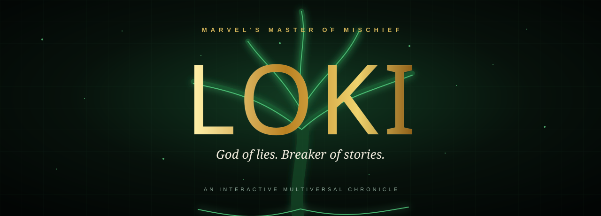

<div align="center">
  

  <br />

  [](https://loki-god-of-stories.is-a.dev)
  [](.github/workflows/pages.yml)
  [](LICENSE)

  **Every lie. Every life. Every glorious purpose.**

  A cinematic, interactive chronicle of Marvel's Loki—built as a mythic editorial experience around Yggdrasil, the living spine of the multiverse.
</div>

---

## ✦ Enter the chronicle

This fan-made experience follows Loki from the abandoned child of Jotunheim to the God of Stories. It combines comic-book composition, Norse symbolism, procedural animation, and responsive storytelling in a zero-build static site.

### What lives inside

- **Procedural Yggdrasil** with glowing branches, flowing energy, particles, and pointer parallax
- **Complete character dossier** covering origins, abilities, identities, costumes, and evolution
- **Interactive arcane index** for Loki's powers and magical disciplines
- **Variant archive** featuring Lady Loki, Kid Loki, Ikol, Agent Loki, Sylvie, and President Loki
- **Essential comics library** from *Journey Into Mystery* to *Immortal Thor*
- **MCU sacred timeline** from Jotunheim to the throne beyond time
- **Relationship constellation** mapping family, friends, mirrors, and adversaries
- **Motion-conscious design** with reduced-motion support and responsive layouts

## ◈ Visual system

| Element | Direction |
|---|---|
| Palette | Asgardian gold · temporal green · void black |
| Typography | Compressed comic display · mythic editorial serif · clean UI sans |
| Motion | Branch flow · particles · parallax · scroll reveals · portal rotation |
| Structure | Marvel Comics × Norse mythology × cinematic storytelling |

## ⚡ Run locally

No dependency installation or build step is required.

```bash
python3 -m http.server 4173
```

Then open `http://localhost:4173`.

## ᛚ Repository map

```text
.
├── index.html            # Document shell and metadata
├── app-static.js         # Content, interaction, and procedural Yggdrasil
├── style.css             # Visual system, layout, motion, and responsive rules
├── app.js                # React + Framer Motion + Three.js source concept
├── assets/               # Repository artwork
└── .github/workflows/    # GitHub Pages deployment
```

## ✧ Domain

The intended custom domain is [`loki-god-of-stories.is-a.dev`](https://loki-god-of-stories.is-a.dev), registered through the community-maintained [is-a.dev registry](https://github.com/is-a-dev/register).

## Legal

This is an unofficial, non-commercial fan-made tribute. Marvel, Loki, and all associated characters and marks are trademarks of Marvel Entertainment. No affiliation or endorsement is implied.

The original site code is available under the [MIT License](LICENSE). That license does not grant rights to Marvel-owned characters, names, or trademarks.

<div align="center">
  <br />
  <sub>FOR THOSE BURDENED WITH GLORIOUS PURPOSE</sub>
</div>
